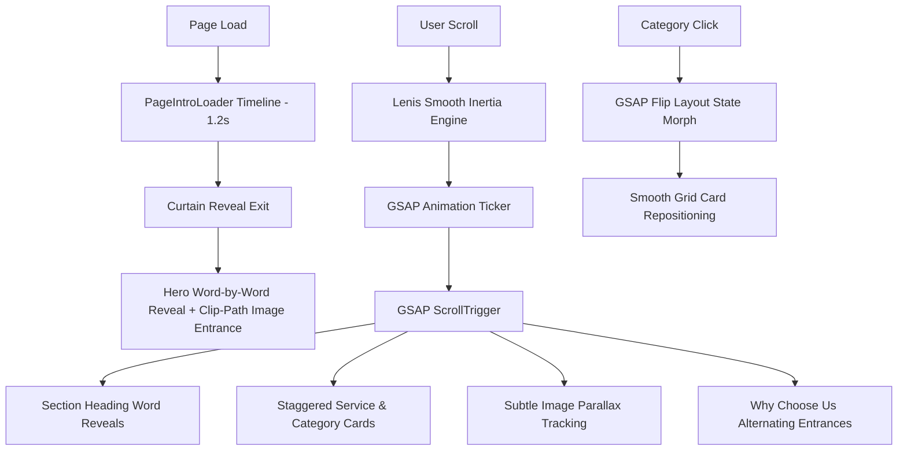

<div align="center">

# 🦷 Shree Dental Care
### *Advanced, Painless & Precision Dentistry in Nigdi-Pradhikaran, PCMC*

[](https://react.dev/)
[](https://vitejs.dev/)
[](https://tailwindcss.com/)
[](https://greensock.com/gsap/)
[](https://github.com/darkroomengineering/lenis)
[](LICENSE)

<p align="center">
  A motion-driven, responsive clinical website engineered for <strong>Shree Dental Care (Dr. Shrikant Rao, BDS)</strong>. Built with a focus on patient reassurance, transparent pricing, authentic dental photography, fluid GSAP ScrollTrigger animations, and mobile conversion.
</p>

[Explore Website](#-features-overview) • [Motion Architecture](#-motion-design-system) • [Clinic Details](#-clinic-profile) • [Getting Started](#-getting-started) • [Tech Stack](#%EF%B8%8F-technology-stack)

---

</div>

## 🏥 Clinic Profile

| Attribute | Details |
| :--- | :--- |
| **Clinic Name** | **Shree Dental Care** (Dr. Shrikant Rao) |
| **Chief Surgeon** | **Dr. Shrikant Rao (B.D.S. — Bachelor of Dental Surgery)** |
| **Experience** | 12+ Years Clinical Excellence • Chief Dental Surgeon & Implantologist |
| **Address** | Shop Number 2, Royal Arcade, Near Swimming Tank / Akurdi BSNL Office, Sector No. 27, Pradhikaran, Nigdi, Pimpri-Chinchwad, Maharashtra 411044 |
| **Helpline / Phone** | `+91 95118 33202` |
| **Operating Hours** | Monday to Saturday: **12:00 PM – 8:00 PM** (Sunday: Closed) |
| **Consultation Fee** | **₹200 – ₹500** (Transparent, upfront diagnostic estimate) |
| **Core Specialities** | Painless Rotary Root Canals, Zirconia CAD-CAM Crowns & Bridges, Dental Implants, Cosmetic Dentistry & Whitening, Wisdom Tooth Surgeries, Periodontics |
| **Verified Portals** | Practo Verified Partner • Google Verified |

---

## ✨ Features Overview

### 1. 🎬 Cinematic Hero & Page Intro
- **1.2s Brand Reveal Intro**: Clean white backdrop with logo scale entrance, turquoise loading line indicator, and smooth curtain exit.
- **Word-by-Word Headline Reveal**: *"A Healthier Smile Starts With The Right Care."* staggered using overflow-hidden spans.
- **Clip-Path Image Entrance**: Main operatory photograph expands into view through an animated polygon mask with gentle ScrollTrigger parallax.

### 2. 📸 Dedicated Visual Categories ("Explore the World of Dental Care")
Detailed photographic cards covering 8 essential dental disciplines:
1. **General Dentistry**: Intraoral examinations & preventive dental cleanings.
2. **Root Canal Treatment (RCT)**: Computer-guided rotary endodontics & apex locators.
3. **Cosmetic Dentistry**: Smile makeovers, porcelain veneers & diastema gap closures.
4. **Dental Implants**: Permanent titanium osseointegrated root replacements.
5. **Teeth Whitening**: In-office chairside bleaching lifting stains 6–8 shades.
6. **Braces & Orthodontics**: Clear aligners and digital bite corrections.
7. **Wisdom Tooth Extraction**: Atraumatic surgical extraction with zero sharp pain.
8. **Gum Care & Periodontics**: Ultrasonic calculus removal & flap surgeries.

### 3. 🖼️ Premium Gallery with GSAP Flip ("A Glimpse Into Modern Dental Care")
- **Masonry Layout**: Varied aspect ratios displaying pristine operatory bays and sterilization suites.
- **GSAP Flip Filtering**: Real-time layout morphing between categories (*All, General Dentistry, Cosmetic Dentistry, Dental Implants, Orthodontics, Clinic Interior*).
- **Interactive Lightbox Modal**: High-res full-screen zoom, keyboard arrow navigation (`←`, `→`, `Esc`), and direct consultation booking.

### 4. 🧭 Interactive Tooth Discomfort Navigator
- Visual dental arch map allowing prospective patients to click their problem area (*Molars, Front Teeth, Wisdom Teeth, Missing Gap, Gums*) to instantly reveal symptoms, recommended treatments, and expected care steps.

### 5. ⚡ 30-Second Dental Self-Check Assessment
- Interactive 3-step self-triage wizard evaluating dental symptoms, urgency level, and dental anxiety.
- Generates an actionable recommendation with an instant **"Send Assessment to Dr. Rao on WhatsApp"** button.

### 6. 💰 Transparent Treatment Cost Estimator
- Interactive multi-select calculator previewing realistic clinical cost ranges (*Consultation, Rotary RCT, Zirconia Crowns, Whitening, Implants*).
- Displays duration, warranty information, and 0% card EMI estimates.

### 7. 🛡️ Hospital-Grade Sterilization & Fear-Free Care
- Transparent breakdown of safety standards: Class-B vacuum autoclaving, individual sealed pouches opened in front of the patient, and topical numbing gel prior to any injection.

### 8. 📅 Dual Appointment Scheduling System
- **Inline Appointment Section**: High-converting full-width booking section placed seamlessly above the footer.
- **Interactive Booking Modal**: 3-step scheduling wizard generating pre-formatted WhatsApp appointment confirmations to `+91 95118 33202`.

### 9. 📱 Mobile-First Quick Actions & Custom Cursor
- **Desktop**: Subtle precision cursor dot with smooth outer follower circle that magnetically expands over interactive elements.
- **Mobile**: Sticky bottom action bar (*"Call Doctor"*, *"Map Navigation"*, *"Book Slot"*) placed cleanly below a floating WhatsApp button.
- **Animated Hamburger Drawer**: Full-screen slide-down navigation menu with touch-friendly links.

---

## 🎨 Motion Design System

The application integrates GSAP and Lenis into a unified, high-performance animation pipeline:



- **`gsap.matchMedia()` Responsive Rules**:
  - `(min-width: 1024px)`: Desktop polygon clip-paths, continuous parallax, and cursor follower.
  - `(max-width: 1023px)`: Lightweight slide/fade transitions, shorter staggers, and zero viewport clipping.
- **Accessibility**: Automatically disables animations and smooth inertia scrolling if `prefers-reduced-motion` is enabled.

---

## 🛠️ Technology Stack

| Category | Tools & Libraries |
| :--- | :--- |
| **Frontend Framework** | [React 18](https://react.dev/) + [Vite 6](https://vitejs.dev/) |
| **Styling** | [Tailwind CSS v3](https://tailwindcss.com/) + Custom Medical Palette |
| **Animation Engine** | [GSAP 3](https://greensock.com/) (Core, ScrollTrigger, Flip) |
| **Smooth Scrolling** | [Lenis](https://github.com/darkroomengineering/lenis) |
| **Carousel / Sliders** | [Swiper.js](https://swiperjs.com/) |
| **Icons** | [Lucide React](https://lucide.dev/) |
| **Typography** | [Outfit](https://fonts.google.com/specimen/Outfit) & [Plus Jakarta Sans](https://fonts.google.com/specimen/Plus+Jakarta+Sans) |
| **SEO & Schema** | LocalBusiness JSON-LD Structured Data for Google Rich Snippets |

---

## 📁 Project Structure

```
d:\Clients\dentist\
├── index.html                    # SEO meta, Google Fonts & LocalBusiness JSON-LD schema
├── package.json                  # Dependencies (React, Vite, GSAP, Lenis, Swiper)
├── tailwind.config.js            # Custom dental cyan/teal palette & shadow system
├── vite.config.js                # Vite build configuration (relative base support)
└── src/
    ├── main.jsx                  # Application entry point
    ├── App.jsx                   # Master layout, smooth scroll init & modal state
    ├── index.css                 # Tailwind directives, custom glassmorphism & gradients
    ├── data/
    │   ├── clinicData.js         # Doctor bio, treatments, timings, FAQs, testimonials
    │   └── dentalImages.js       # Curated high-res Unsplash clinical photography
    ├── utils/
    │   └── smoothScroll.js       # Lenis + GSAP ScrollTrigger ticker integration
    └── components/
        ├── PageIntroLoader.jsx           # 1.2s cinematic intro loader
        ├── CustomCursor.jsx              # Desktop-only smooth magnetic cursor
        ├── AnimatedButton.jsx            # Reusable interactive motion button
        ├── Navbar.jsx                    # Live status badge (12-8 PM), mobile menu
        ├── Hero.jsx                      # Word-by-word reveal & clip-path photography
        ├── DentalCategoriesSection.jsx   # 8-category clinical photographic grid
        ├── Services.jsx                  # Image-based treatment cards with hover zoom
        ├── ModernDentalGallery.jsx       # Masonry gallery with GSAP Flip & Lightbox
        ├── ToothNavigator.jsx            # Interactive dental arch & discomfort map
        ├── SmileAssessmentQuiz.jsx       # 30-sec self-triage assessment tool
        ├── TreatmentCostEstimator.jsx    # Transparent pricing & EMI calculator
        ├── DoctorProfile.jsx             # Dr. Shrikant Rao (BDS) bio & philosophy
        ├── SmileGallery.jsx              # Interactive before/after transformation slider
        ├── SterilizationAndHygiene.jsx   # Hospital-grade sterilization protocol
        ├── LocationAndHours.jsx          # Royal Arcade landmarks, weekly schedule & Map
        ├── Testimonials.jsx              # Swiper.js verified patient review carousel
        ├── InlineAppointmentSection.jsx  # High-converting inline booking form
        ├── FaqSection.jsx                # Interactive Q&A accordions
        ├── Footer.jsx                    # Contact details, credits & scroll-to-top
        ├── FloatingActions.jsx           # Floating WhatsApp & mobile quick action bar
        └── AppointmentModal.jsx          # Client-side booking wizard modal
```

---

## 🚀 Getting Started

### Prerequisites
- [Node.js](https://nodejs.org/) (v18.0 or higher)
- `npm` or `pnpm`

### Installation

1. **Clone the Repository**:
   ```bash
   git clone https://github.com/Chinmay-Jain-29/Shree-Dental-Clinic.git
   cd Shree-Dental-Clinic
   ```

2. **Install Dependencies**:
   ```bash
   npm install
   ```

3. **Start Development Server**:
   ```bash
   npm run dev
   ```
   Open **`http://localhost:5173`** in your browser.

4. **Build for Production**:
   ```bash
   npm run build
   ```
   The compiled, optimized production bundle will be generated in `dist/`.

5. **Preview Production Build**:
   ```bash
   npm run preview
   ```

---

## 📍 Clinic Location & Landmark Guide

```
Shree Dental Care
Shop Number 2, Royal Arcade,
Near Swimming Tank / Akurdi BSNL Office,
Sector No. 27, Pradhikaran, Nigdi,
Pimpri-Chinchwad, Pune, Maharashtra 411044
```
- **5 minutes** from Akurdi Railway Station
- Located along the main connecting arterial road between Sector 26 and Sector 27
- Ample roadside parking and ground-level accessibility

---

## 📄 License & Attribution

- **License**: MIT License.
- **Imagery**: Authentic healthcare photography curated via [Unsplash](https://unsplash.com/).
- **Developed for**: Shree Dental Care (Dr. Shrikant Rao, BDS).
